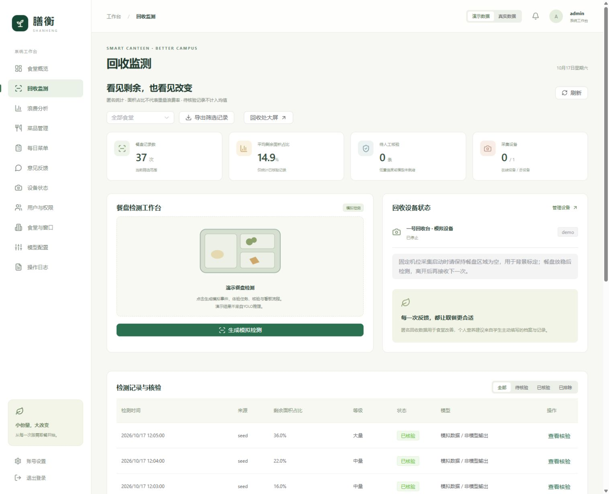
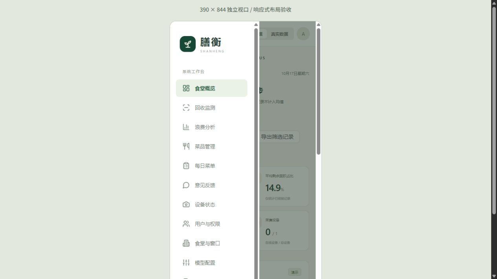

# 验收记录

本地验证：2026-10-17（Asia/Shanghai）。

- 31项Python测试通过，包括认证、会话撤销、越权访问、个人数据隔离、营养公式、过敏与预算、模型输出校验/超时、未授权不发送数据、任务幂等、截图清理、设备断线、数据库迁移及旧记录导入。
- Vue TypeScript检查及Vite生产构建通过。存在第三方UI/图表包体积提示，不影响构建；后续按需导入可进一步优化。
- Alembic检查：模型与当前数据库结构一致，没有待生成升级操作。
- 实际浏览器：学生演示登录、推荐餐保存为自报饮食记录；管理员登录、提交模拟检测、worker处理并更新统计；390×844独立视口布局和手机侧边导航。
- Windows脚本：启动→健康检查→停止进程树→重新启动→健康检查通过。服务仅监听127.0.0.1。

预览：

尚未进行真实摄像头/YOLO权重/外部大模型服务及PostgreSQL实例联调，因为未提供这些资源。视觉与大模型使用真实适配代码及隔离模拟测试，不能据此宣称现场准确率或上线容量。
